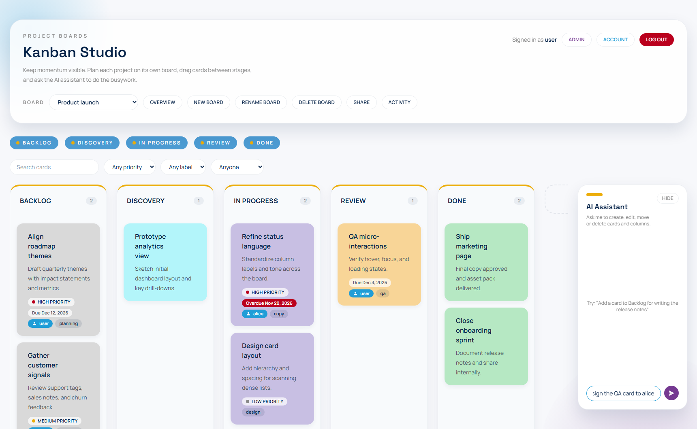

# Kanban Studio

Project management app with accounts, multiple Kanban boards per user and an AI assistant: Next.js frontend, FastAPI backend, SQLite, AI chat via OpenRouter. Runs in one Docker container.



Requires Docker and a `.env` file in the repo root containing `OPENROUTER_API_KEY`. Optional settings in `.env`:

- `SESSION_SECRET`: a long random string that signs the sign-in cookie. Without it a random one is used and every restart signs you out.
- `SESSION_HTTPS_ONLY=true`: only when the app is served over HTTPS (marks the cookie Secure).

Sign in with `user` / `password`, or create an account from the sign-in page.

## Run

Mac / Linux:

```
./scripts/start.sh
./scripts/stop.sh
```

Windows:

```
powershell -ExecutionPolicy Bypass -File scripts\start.ps1
powershell -ExecutionPolicy Bypass -File scripts\stop.ps1
```

The app runs at http://localhost:8000.

## Test

Backend (in the container image built by the start script):

```
docker run --rm pm uv run --no-sync pytest
```

Add `--env-file .env` after `--rm` to also run the tests that call OpenRouter (otherwise they are skipped). `pytest -m live` runs only those.

Frontend (from `frontend/`, after `npm install`). The e2e tests build the image and run their own throwaway container on port 8001, so your boards on port 8000 are never touched; the chat test calls the real AI:

```
npm run test:unit
npm run test:e2e
```
