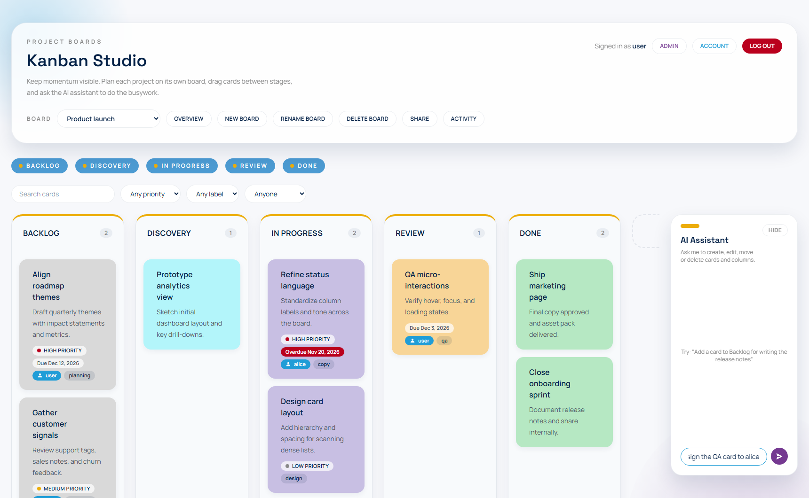

# Building Kanban Studio: A Guided Tour

This tutorial walks through how Kanban Studio was built: a project management app with a drag-and-drop Kanban board, sign-in, a database, and an AI assistant that can change the board for you.

It is written for someone with up to a year of frontend experience. You should be comfortable with HTML, CSS, JavaScript and the basics of React (components, props, `useState`). Everything else, including the Python backend, Docker and the AI integration, is explained from the ground up, usually by comparing it to something you already know from the frontend.



## Contents

1. [What the app does](#1-what-the-app-does)
2. [The technology, in plain terms](#2-the-technology-in-plain-terms)
3. [High-level walkthrough](#3-high-level-walkthrough)
4. [Detailed code review](#4-detailed-code-review)
5. [Bugs we hit and what they teach](#5-bugs-we-hit-and-what-they-teach)
6. [Running it yourself](#6-running-it-yourself)
7. [Self-review: five ways to improve the code](#7-self-review-five-ways-to-improve-the-code)

---

## 1. What the app does

- You sign in (for this MVP the only account is `user` / `password`).
- You see one Kanban board with five fixed columns: Backlog, Discovery, In Progress, Review, Done.
- You can rename columns, add, edit, delete and drag cards. Every change is saved to a database, so it is still there after a reload or a server restart.
- A chat sidebar lets you ask an AI to create, edit, move or delete cards ("Add a card for release notes to Backlog, then move it to In Progress"). The board updates instantly when the AI makes a change.
- Everything runs in a single Docker container on your machine at http://localhost:8000.

---

## 2. The technology, in plain terms

| Layer | Tool | What it does here | Frontend analogy |
|---|---|---|---|
| UI framework | **Next.js 16** + **React 19** | Builds the pages and components | You know this one |
| Language | **TypeScript 6** | JavaScript with types | |
| Styling | **Tailwind CSS 4** | Utility classes like `rounded-2xl px-6` | |
| Drag and drop | **dnd-kit** | Makes cards draggable and columns droppable | |
| Backend framework | **FastAPI** (Python) | Defines the `/api/...` endpoints | Like Express or a Next.js route handler |
| Data validation | **Pydantic** | Checks request and database data has the right shape | Like Zod |
| Python packages | **uv** | Installs Python dependencies from a lockfile | Like npm with `package-lock.json` |
| Database | **SQLite** | A database stored in a single file | Like `localStorage`, but on the server and queryable |
| Packaging | **Docker** | Bundles everything into one runnable "container" | Like a zip of the whole app plus its runtime |
| AI | **OpenRouter** + the `openai` Python SDK | Sends chat requests to the `anthropic/claude-haiku-5.5` model | Like calling any third-party REST API |
| Tests | **pytest**, **Vitest** + Testing Library, **Playwright** | Backend tests, component tests, real-browser tests | Vitest is like Jest |

A few of these deserve a sentence more.

**Next.js static export.** Next.js can run as a server, but here we set `output: "export"`, which makes `npm run build` produce plain HTML, CSS and JS files in `frontend/out`. There is no Node server in production; the Python backend simply serves those files. That is why every page component is a client component (`"use client"`) and talks to the backend with `fetch`.

**FastAPI.** A Python web framework. You write a normal Python function and put a decorator on it, and FastAPI turns it into an HTTP endpoint:

```python
@app.get("/api/health")
def health():
    return {"status": "ok"}
```

That is roughly the same as `app.get("/api/health", (req, res) => res.json({ status: "ok" }))` in Express.

**Pydantic.** You describe the shape of your data as a class, and Pydantic validates incoming data against it. If you have used Zod, `z.object({ title: z.string().min(1) })` is the same idea as a Pydantic model with `title: str = Field(min_length=1)`. FastAPI uses these models to validate request bodies automatically and return a `422` error when the shape is wrong.

**Docker.** A container is an isolated mini-computer with exactly the software your app needs (a specific Python version, your packages, your built frontend). The recipe is a `Dockerfile`. "It works on my machine" stops being a problem because everyone runs the same container.

**Structured Outputs.** Normally an AI model replies with free text. With Structured Outputs you give the model a JSON Schema, and it is forced to reply with JSON matching that schema. This is what lets the AI safely return "operations" our code can apply to the board.

---

## 3. High-level walkthrough

### 3.1 The architecture

```
                       Docker container "pm" (port 8000)
 Browser               +------------------------------------------------+
 +-------------+       |  FastAPI (uvicorn)                              |
 | React app   | ----> |   /api/login, /api/me, /api/logout              |
 | (static     |  HTTP |   /api/board  (GET / PUT)  ---> SQLite file      |
 |  files from |       |   /api/chat   ------------> OpenRouter (AI) ---> |
 |  Next.js)   | <---- |   /  (serves the built Next.js files)           |
 +-------------+       +------------------------------------------------+
                                       |
                              Docker volume "pm-data"
                              (keeps pm.db between restarts)
```

One server does two jobs: it serves the frontend files, and it answers API requests. Because both come from the same address (`localhost:8000`), the browser sends the sign-in cookie automatically and there are no CORS headaches.

### 3.2 The folder layout

```
Dockerfile            builds the frontend, then the Python image that serves it
scripts/              start.sh / stop.sh (Mac, Linux), start.ps1 / stop.ps1 (Windows)
backend/
  app/main.py         FastAPI app: routes, sign-in, static files
  app/db.py           SQLite access
  app/board.py        board data models, default board, AI operations
  app/ai.py           OpenRouter calls and the AI system prompt
  tests/              pytest tests
frontend/
  src/app/page.tsx    the only page: login form or board
  src/lib/api.ts      every fetch call to the backend
  src/lib/kanban.ts   board types and helper functions
  src/components/     KanbanBoard, KanbanColumn, KanbanCard, ChatSidebar, LoginForm, ...
  tests/              Playwright browser tests
docs/                 the plan, database design, this tutorial
```

### 3.3 How it was built, step by step

The work followed a written plan (`docs/PLAN.md`) split into ten parts. Each part had a checklist, tests and success criteria, and the next part only started after the previous one was checked by hand. This is a good habit for any project: small steps, each one working and tested before moving on.

| Part | What happened |
|---|---|
| 1. Plan | Reviewed the existing frontend demo, agreed on decisions (model, sign-in method, database shape), upgraded dependencies |
| 2. Scaffolding | Created the FastAPI app, Dockerfile and start/stop scripts with a "hello world" page |
| 3. Frontend in Docker | Switched Next.js to static export, served it from FastAPI, added card editing |
| 4. Sign-in | Session cookie login, login form, log out button |
| 5. Database design | Wrote down the tables and the JSON format before writing any database code |
| 6. Backend board API | `GET` and `PUT /api/board`, saved in SQLite |
| 7. Frontend persistence | The board loads from and saves to the API |
| 8. AI connectivity | A first "What is 2+2?" call to OpenRouter |
| 9. AI board changes | `/api/chat` with Structured Outputs and board operations |
| 10. Chat sidebar | The chat UI, plus a bug fix the browser tests uncovered |

After that came a visual refresh (column colors, hover effects), and delete support for the AI.

### 3.4 Following one request end to end

Here is what happens when you type "Move the roadmap card to Done" into the chat:

1. `ChatSidebar` calls `sendChat(message, history)`, which sends `POST /api/chat` with the message and the earlier conversation.
2. FastAPI checks the session cookie (`current_user`), loads your board from SQLite, and sends the AI: instructions, your board as JSON, the conversation, and your new message.
3. The AI replies with JSON like `{"reply": "Moved it.", "operations": [{"type": "move_card", "card_id": "card-1", "column_id": "col-done", ...}]}`.
4. `apply_operations` applies those operations to a copy of the board, skipping anything invalid. If the board changed, it is saved.
5. The response `{reply, board}` goes back to the browser. `ChatSidebar` shows the reply and hands the new board to `KanbanBoard`, which re-renders. The card jumps to Done without a page reload.

---

## 4. Detailed code review

### 4.1 Packaging: the Dockerfile

```dockerfile
FROM node:26-slim AS frontend

WORKDIR /frontend
COPY frontend/package.json frontend/package-lock.json ./
RUN npm ci
COPY frontend/ ./
RUN npm run build

FROM python:3.15-slim

COPY --from=ghcr.io/astral-sh/uv:0.13.9 /uv /uvx /bin/

WORKDIR /app

COPY backend/pyproject.toml backend/uv.lock ./
RUN uv sync --frozen

COPY backend/ ./
COPY --from=frontend /frontend/out ./static

EXPOSE 8000
CMD ["uv", "run", "--no-sync", "uvicorn", "app.main:app", "--host", "0.0.0.0", "--port", "8000"]
```

This is a **multi-stage build**:

- **Stage 1** (`frontend`) uses a Node image to run `npm ci` and `npm run build`, producing `/frontend/out`.
- **Stage 2** starts from a clean Python image, installs the Python packages, and copies in only the built files from stage 1 (`COPY --from=frontend ...`). Node and `node_modules` never make it into the final image, so it stays small.

Notice the order: `package.json` and the lockfile are copied and installed *before* the rest of the code. Docker caches each step, so if you only change a component, Docker reuses the cached `npm ci` step and the rebuild is much faster.

The start script builds the image and runs it:

```sh
docker build -t pm .
if [ -n "$(docker ps -aq -f name=^pm$)" ]; then
  docker rm -f pm > /dev/null
fi
docker run -d --name pm -p 8000:8000 --env-file .env -v pm-data:/app/data pm > /dev/null
```

- `-p 8000:8000` connects port 8000 on your machine to port 8000 in the container.
- `--env-file .env` passes in `OPENROUTER_API_KEY` without baking the secret into the image.
- `-v pm-data:/app/data` mounts a **named volume**. Containers are disposable: when one is removed, its files go with it. A volume lives outside the container, so the SQLite file in `/app/data` survives restarts and rebuilds.

### 4.2 The backend entry point: `main.py`

```python
@asynccontextmanager
async def lifespan(app: FastAPI):
    db.init_db()
    db.add_user(USERNAME)
    yield


app = FastAPI(lifespan=lifespan)
app.add_middleware(SessionMiddleware, secret_key=secrets.token_hex(32))
```

`lifespan` runs once when the server starts (the code before `yield`) and once when it stops (after `yield`, unused here). It creates the database tables and the `user` row if they do not exist yet.

At the very bottom of the file:

```python
app.mount("/", StaticFiles(directory=STATIC_DIR, html=True), name="static")
```

This serves the built frontend for any path that is not an API route. It must be **last**: routes are matched in order, and a catch-all mounted at `/` registered first would swallow every `/api/...` request.

### 4.3 Sign-in with a session cookie

The backend side is short:

```python
def current_user(request: Request) -> str:
    username = request.session.get("username")
    if not username:
        raise HTTPException(status_code=401, detail="Not signed in")
    return username


@app.post("/api/login")
def login(credentials: Credentials, request: Request):
    if credentials.username != USERNAME or credentials.password != PASSWORD:
        raise HTTPException(status_code=401, detail="Invalid username or password")
    request.session["username"] = credentials.username
    return {"username": credentials.username}
```

> **Update:** this is the MVP version. The login now checks the password against an argon2 hash stored in the database and limits failed attempts; see self-review suggestion 5 and `backend/app/auth.py`.

- `SessionMiddleware` stores the session in a **signed cookie**. "Signed" means the server adds a cryptographic signature, so the browser can hold the cookie but cannot tamper with it (changing the username would break the signature).
- `current_user` is a **dependency**. Any route that declares `username: str = Depends(current_user)` gets the signed-in username, or the request is rejected with `401` before the route code runs. Think of it as a per-route middleware:

```python
@app.get("/api/me")
def me(username: str = Depends(current_user)):
    return {"username": username}
```

On the frontend, `page.tsx` is a small **state machine** with three states:

```tsx
type AuthState = "loading" | "signed-out" | "signed-in";

export default function Home() {
  const [authState, setAuthState] = useState<AuthState>("loading");
  const [board, setBoard] = useState<BoardData | null>(null);

  useEffect(() => {
    getCurrentUser().then((username) =>
      setAuthState(username ? "signed-in" : "signed-out")
    );
  }, []);

  useEffect(() => {
    if (authState === "signed-in") {
      getBoard().then(setBoard);
    }
  }, [authState]);
  ...
  if (authState === "loading") {
    return null;
  }
  if (authState === "signed-out") {
    return <LoginForm onLogin={handleLogin} />;
  }
  if (!board) {
    return <p ...>Loading board...</p>;
  }
  return <KanbanBoard initialBoard={board} onLogout={handleLogout} />;
}
```

Two things worth copying into your own projects:

- **Use a union type instead of several booleans.** `"loading" | "signed-out" | "signed-in"` makes impossible combinations (like "loading and signed in at once") impossible to write.
- **Render `null` while loading** the sign-in status. Otherwise the login form flashes up for a split second for someone who is already signed in.

`LoginForm` takes an `onLogin` function that returns a `Promise<boolean>`. The form does not know how logging in works; it only knows whether it worked:

```tsx
const handleSubmit = async (event: FormEvent<HTMLFormElement>) => {
  event.preventDefault();
  setError("");
  if (!(await onLogin(username, password))) {
    setError("Invalid username or password.");
  }
};
```

### 4.4 The data: one JSON document per user

The database design (`docs/DATABASE.md`) is deliberately simple. Two tables:

```sql
CREATE TABLE IF NOT EXISTS users (
    id INTEGER PRIMARY KEY,
    username TEXT NOT NULL UNIQUE,
    created_at TEXT NOT NULL DEFAULT CURRENT_TIMESTAMP
);

CREATE TABLE IF NOT EXISTS boards (
    id INTEGER PRIMARY KEY,
    user_id INTEGER NOT NULL UNIQUE REFERENCES users(id),
    data TEXT NOT NULL,
    updated_at TEXT NOT NULL DEFAULT CURRENT_TIMESTAMP
);
```

The whole board lives in `boards.data` as a JSON string, in exactly the shape the frontend already used:

```ts
type BoardData = {
  columns: { id: string; title: string; cardIds: string[] }[];
  cards: Record<string, { id: string; title: string; details: string }>;
};
```

Why not separate `columns` and `cards` tables? Because the app always loads and saves the whole board at once, so one row per board is the simplest thing that works. Splitting into tables would only pay off with features like searching cards across many boards.

Notice the shape: columns hold an ordered list of card **ids**, and the cards live in a lookup object. Moving a card is just moving an id string from one array to another; the card object itself never moves. This is called **normalized** state and it is a common pattern in React apps too.

Saving uses an **upsert** ("insert, or update if it already exists"):

```python
def save_board(username: str, data: str) -> None:
    with closing(connect()) as conn:
        conn.execute(
            "INSERT INTO boards (user_id, data) SELECT id, ? FROM users WHERE username = ?"
            " ON CONFLICT (user_id) DO UPDATE"
            " SET data = excluded.data, updated_at = CURRENT_TIMESTAMP",
            (data, username),
        )
```

The `?` placeholders are important. The values are passed separately, never pasted into the SQL string, which protects against **SQL injection** (the database equivalent of not using `innerHTML` with user input).

The Pydantic models in `board.py` validate the board on the way in:

```python
class Card(BaseModel):
    model_config = ConfigDict(extra="forbid")

    id: str = Field(min_length=1)
    title: str = Field(min_length=1)
    details: str


class Board(BaseModel):
    model_config = ConfigDict(extra="forbid")

    columns: list[Column]
    cards: dict[str, Card]

    @model_validator(mode="after")
    def check_cards(self):
        placed = sorted(card_id for column in self.columns for card_id in column.cardIds)
        if placed != sorted(self.cards):
            raise ValueError("Every card must appear in exactly one column")
        if any(key != card.id for key, card in self.cards.items()):
            raise ValueError("Card keys must match card ids")
        return self
```

The field rules catch wrong types and empty titles. The `model_validator` catches mistakes a schema cannot express: a card that is in no column (invisible), in two columns (shown twice), or a column pointing at a card that does not exist (a crash in the UI). Validating at the boundary means a bad save can never corrupt what is stored.

The `PUT` route adds one more rule: columns are fixed, so their ids must match what is stored (renaming is fine, the title is not the id):

```python
@app.put("/api/board")
def put_board(board: Board, username: str = Depends(current_user)) -> Board:
    if column_ids(board) != column_ids(load_board(username)):
        raise HTTPException(status_code=422, detail="Columns cannot be added, removed or reordered")
    db.save_board(username, board.model_dump_json())
    return board
```

### 4.5 The frontend data layer: `api.ts`

Every `fetch` lives in one file, so components never build URLs or headers themselves:

```ts
export const getBoard = async (): Promise<BoardData> => {
  const response = await fetch("/api/board");
  return response.json();
};

export const saveBoard = async (board: BoardData) => {
  const response = await fetch("/api/board", {
    method: "PUT",
    headers: { "Content-Type": "application/json" },
    body: JSON.stringify(board),
  });
  return response.ok;
};
```

The URLs are relative (`/api/board`, not `http://localhost:8000/api/board`) because the frontend and API share an origin. The browser sends the session cookie automatically for same-origin requests.

Keeping all API calls in one module is a habit worth forming: when the API changes, there is one place to update, and tests can replace `fetch` in one spot.

### 4.6 The board: state, saving and drag and drop

`KanbanBoard` owns the board state. The heart of it is two small functions:

```tsx
const persist = (next: BoardData) => {
  saveBoard(next)
    .catch(() => false)
    .then((ok) => setSaveFailed(!ok));
};

const update = (next: BoardData) => {
  setBoard(next);
  persist(next);
};
```

This is an **optimistic update**: the UI changes immediately, and the save happens in the background. If the save fails (server error, or the server is not reachable and `fetch` throws), an error message appears. `.catch(() => false)` turns a network exception into the same "not ok" result as an HTTP error, so both are handled by one line.

> **Update:** this is the original version. Self-review suggestion 1 has since been implemented: boards now carry a version number, `persist` queues saves and sends them one at a time, and a conflicting save loads the latest board instead of overwriting it. See `KanbanBoard.tsx` and `docs/DATABASE.md` for the current code.

Every user action builds a new board object and passes it to `update`. For example, adding a card:

```tsx
const handleAddCard = (columnId: string, title: string, details: string) => {
  const id = createId("card");
  update({
    ...board,
    cards: {
      ...board.cards,
      [id]: { id, title, details: details || "No details yet." },
    },
    columns: board.columns.map((column) =>
      column.id === columnId
        ? { ...column, cardIds: [...column.cardIds, id] }
        : column
    ),
  });
};
```

> **Update:** these updates now live as small pure functions in `kanban.ts` (`addCard`, `editCard`, `deleteCard`, `renameColumn`), so the handler is a single line: `update(addCard(board, columnId, { id: createId("card"), title, details }))`. Missing details are now an empty string. See self-review suggestion 4.

This is **immutable updating**: nothing is changed in place. Spreads (`...board`) copy objects, `map` returns a new array, and only the parts that change get new values. React compares old and new state by reference, so mutating the existing object would leave React thinking nothing changed.

Renaming a column is handled differently on purpose:

```tsx
// Typing only updates local state; the title is saved on blur / Enter.
const handleRenameColumn = (columnId: string, title: string) => {
  setBoard({
    ...board,
    columns: board.columns.map((column) =>
      column.id === columnId ? { ...column, title } : column
    ),
  });
};
```

It calls `setBoard`, not `update`, so typing does not send a request per keystroke. The column input saves when you leave it:

```tsx
<input
  value={column.title}
  onChange={(event) => onRename(column.id, event.target.value)}
  onBlur={onRenameDone}
  onKeyDown={(event) => {
    if (event.key === "Enter") event.currentTarget.blur();
  }}
  aria-label="Column title"
/>
```

Pressing Enter calls `blur()`, which triggers `onBlur`, so both paths share one save.

**Drag and drop** uses dnd-kit. The board wraps the columns in a `DndContext`:

```tsx
<DndContext
  id={dndContextId}
  sensors={sensors}
  collisionDetection={closestCorners}
  onDragStart={handleDragStart}
  onDragEnd={handleDragEnd}
>
```

- Each column registers as a drop target with `useDroppable`, and each card as a sortable item with `useSortable`.
- The sensor's `activationConstraint: { distance: 6 }` means a drag only starts after the pointer moves 6 pixels, so a normal click on a button inside a card still works.
- When the drag ends, `moveCard` (a pure function in `kanban.ts`, with its own unit tests) works out the new column arrays.
- `DragOverlay` renders a floating copy of the card under the pointer while dragging.

The `id={dndContextId}` comes from React's `useId()`. That fixed a real bug, explained in section 5.

### 4.7 The card: editing, hover styles and colors

Each card has a view mode and an edit mode, switched with local state:

```tsx
const { attributes, listeners, setNodeRef, transform, transition, isDragging } =
  useSortable({ id: card.id, disabled: isEditing });
...
<article
  ref={setNodeRef}
  style={style}
  className={clsx(cardClassName, "group relative ... hover:border-l-[var(--accent-yellow)]", ...)}
  {...(isEditing ? {} : attributes)}
  {...listeners}
  data-testid={`card-${card.id}`}
>
```

- While editing, dragging is disabled, so selecting text in the inputs does not start a drag.
- dnd-kit's `attributes` are also left off while editing. They make the card a `role="button"`, and with dragging disabled, an `aria-disabled="true"` button, which made the form inside it count as disabled. Section 5 has the details.

The card's color comes from its column. Colors are CSS variables in `globals.css`, and `kanban.ts` maps each column id to one:

```css
--card-backlog: #d9d9d9;
--card-discovery: #b3f5fa;
--card-progress: #c8bfe3;
--card-review: #f8d597;
--card-done: #b6e8c3;
```

```ts
export const columnColors: Record<string, string> = {
  "col-backlog": "var(--card-backlog)",
  "col-discovery": "var(--card-discovery)",
  ...
};
```

The edit and delete icons only appear on hover, using Tailwind's `group` feature: the card has the `group` class, and children react to the card's hover with `group-hover:`:

```tsx
<div className="absolute right-3 top-4 flex items-center transition-opacity pointer-fine:opacity-0 pointer-fine:group-hover:opacity-100 pointer-fine:group-focus-within:opacity-100">
```

The `pointer-fine:` prefix is an accessibility and mobile detail. It applies only on devices with a precise pointer (a mouse). Phones and tablets have no hover, so on those the icons are simply always visible. `group-focus-within` also shows them when a keyboard user tabs into the card.

The icons are positioned `absolute` in the corner rather than placed beside the text. An `opacity-0` element is invisible but still takes up space, so the first version squeezed the text into a narrow column even when the icons were hidden.

### 4.8 The AI: prompts, Structured Outputs and operations

`ai.py` talks to OpenRouter. OpenRouter is compatible with OpenAI's API, so the official `openai` Python package works by pointing it at a different URL:

```python
def client() -> OpenAI:
    return OpenAI(
        base_url="https://openrouter.ai/api/v1",
        api_key=os.environ["OPENROUTER_API_KEY"],
    )
```

The key comes from an environment variable and never appears in the code.

Each chat request is built from four parts:

```python
def build_messages(board: Board, history: list[ChatMessage], message: str) -> list[dict]:
    return [
        {"role": "system", "content": SYSTEM_PROMPT},
        {"role": "system", "content": f"Current board JSON:\n{board.model_dump_json()}"},
        *(m.model_dump() for m in history),
        {"role": "user", "content": message},
    ]
```

AI models have no memory between requests. Every request must include everything the model needs: the instructions (system prompt), the current board, the conversation so far, and the new message. The browser keeps the conversation and sends it each time.

The system prompt tells the model what it may do:

```
To change the board, return operations. Allowed operations:
- create_card: card_id (a temporary id you choose, such as "new-1"; ...), column_id, title, details, position ...
- edit_card: card_id, plus the new title and/or details. Use null for a field that should not change.
- move_card: card_id, column_id (the destination; ...), position (0 = top, null = bottom).
- delete_card: card_id. Only delete cards the user clearly asked you to delete; if it is unclear which card
  they mean, ask instead of deleting.
```

And Structured Outputs forces the reply into this shape:

```python
class ChatResult(BaseModel):
    reply: str
    operations: list[Operation]


def chat(board: Board, history: list[ChatMessage], message: str) -> ChatResult:
    response = client().chat.completions.parse(
        model=MODEL,
        messages=build_messages(board, history, message),
        response_format=ChatResult,
        extra_body=REASONING,
    )
    return response.choices[0].message.parsed
```

Passing a Pydantic class as `response_format` makes the SDK convert it into a JSON Schema for the model, then parse the reply back into a `ChatResult` object. No string parsing, no "please reply in JSON" and hoping.

**Why operations instead of letting the AI return a whole new board?** Asking the model to rewrite the entire board risks it silently dropping or altering cards it was not asked to touch. A short list of specific changes is easier for the model to get right, easy to check, and our code stays in control of the actual data.

The operations are applied by a **pure function**: it takes a board and a list of operations and returns a new board, without touching the database or anything else. Pure functions are the easiest code to test.

```python
def apply_operations(board: Board, operations: list[Operation]) -> Board:
    board = board.model_copy(deep=True)
    columns = {column.id: column for column in board.columns}
    new_ids: dict[str, str] = {}

    for op in operations:
        if op.type == "create_card":
            if op.column_id not in columns or not op.title:
                continue
            card_id = f"card-{uuid.uuid4().hex[:12]}"
            if op.card_id:
                new_ids[op.card_id] = card_id
            board.cards[card_id] = Card(id=card_id, title=op.title, details=op.details or "")
            _insert(columns[op.column_id].cardIds, card_id, op.position)
            continue

        card_id = new_ids.get(op.card_id, op.card_id)

        if op.type == "edit_card":
            ...
        elif op.type == "move_card":
            if card_id not in board.cards or op.column_id not in columns:
                continue
            _remove(board, card_id)
            _insert(columns[op.column_id].cardIds, card_id, op.position)

        elif op.type == "delete_card":
            if card_id not in board.cards:
                continue
            _remove(board, card_id)
            del board.cards[card_id]

    return board
```

> **Update:** the current version also collects the operations it skips and returns them with the board (`Applied(board, skipped)`), so the chat can tell the user when a change could not be applied. See self-review suggestion 2.

Key ideas:

- `model_copy(deep=True)` works on a copy, the Python version of immutable updates.
- **Never trust model output blindly.** An operation pointing at a card or column that does not exist is skipped (`continue`) instead of crashing.
- New cards always get an id generated by our code, so the AI can never create duplicate ids. The `new_ids` map exists because of a bug found in Part 10 (section 5): the AI needs a way to refer to a card it just created in the same reply.

The route ties it together:

```python
@app.post("/api/chat")
def chat(request: ChatRequest, username: str = Depends(current_user)) -> ChatResponse:
    board = load_board(username)
    result = ai.chat(board, request.history, request.message)
    updated = apply_operations(board, result.operations)
    if updated != board:
        db.save_board(username, updated.model_dump_json())
    return ChatResponse(reply=result.reply, board=updated)
```

### 4.9 The chat sidebar

`ChatSidebar` keeps the conversation in state and talks to the API:

```tsx
const handleSubmit = async (event: FormEvent<HTMLFormElement>) => {
  event.preventDefault();
  const message = input.trim();
  if (!message || isSending) {
    return;
  }
  const history = messages;
  setMessages([...history, { role: "user", content: message }]);
  setInput("");
  setHasError(false);
  setIsSending(true);
  try {
    const { reply, board } = await sendChat(message, history);
    setMessages((prev) => [...prev, { role: "assistant", content: reply }]);
    onBoardUpdate(board);
  } catch {
    setHasError(true);
  } finally {
    setIsSending(false);
  }
};
```

Details worth noticing:

- `const history = messages` captures the conversation **before** adding the new message, because the API takes the new message and the history separately.
- The reply is added with the **updater form** `setMessages((prev) => ...)`. By the time the reply arrives, `messages` from this render is out of date (we already added the user's message), and the updater always receives the latest state.
- `finally` turns off the loading indicator whether the request succeeded or failed.
- The parent passes `onBoardUpdate={setBoard}`. It does not call `update`, because the backend already saved the AI's board; saving it again would be a wasted request.

The message list uses `role="log"` and the loading text uses `role="status"`. Screen readers announce new content in these regions, and tests can find them by role.

### 4.10 Testing at three levels

**Backend (pytest), run inside the container.** Every test gets its own temporary database through an automatic fixture:

```python
@pytest.fixture(autouse=True)
def db_path(tmp_path, monkeypatch):
    path = tmp_path / "test.db"
    monkeypatch.setenv("DB_PATH", str(path))
    return path
```

AI tests replace the real client with a fake that records what was sent and returns a fixed answer. This is how we test "the board and history are included in the request" without paying for or waiting on a real AI call:

```python
class FakeClient:
    """Stands in for the OpenAI client: records each request and returns a fixed result."""

    def __init__(self, result: ai.ChatResult):
        self.requests = []
        self.result = result
        self.chat = SimpleNamespace(completions=SimpleNamespace(parse=self.parse))

    def parse(self, **kwargs):
        self.requests.append(kwargs)
        return SimpleNamespace(choices=[SimpleNamespace(message=SimpleNamespace(parsed=self.result))])
```

A few tests are marked `live` and really call OpenRouter (for example, "What is 2+2?" and "Delete the QA micro-interactions card"). They are skipped unless the API key is provided.

**Frontend components (Vitest + Testing Library).** `fetch` is replaced with a mock, and tests check what the component would have sent:

```tsx
const savedBoards = (): BoardData[] =>
  fetchMock.mock.calls
    .filter(([url, init]) => url === "/api/board" && init?.method === "PUT")
    .map(([, init]) => JSON.parse(init.body));

it("saves a column rename on blur, not on every keystroke", async () => {
  renderBoard();
  const input = within(getFirstColumn()).getByLabelText("Column title");
  await userEvent.clear(input);
  await userEvent.type(input, "New Name");
  expect(input).toHaveValue("New Name");
  expect(savedBoards()).toHaveLength(0);

  await userEvent.tab();
  await waitFor(() => expect(savedBoards()).toHaveLength(1));
  expect(lastSaved().columns[0].title).toBe("New Name");
});
```

The tests find elements the way a user would: by label (`getByLabelText`) and role (`getByRole("button", { name: "Send" })`), not by CSS class. Tests written that way survive styling changes, which is exactly what happened during the visual refresh: no tests broke because colors changed.

**Real browser (Playwright).** These tests drive Chromium against the running container: sign in, drag a card, reload, check it stayed. The chat test even asks the real AI to create a card and move it to Done.

---

## 5. Bugs we hit and what they teach

Every bug below was fixed by finding its root cause first, not by trying things until the error went away.

**1. Hydration mismatch.** The browser console showed a React error about `DndDescribedBy-3` versus `DndDescribedBy-0`. During the build, Next.js renders the page to HTML once ("server render"), then React renders it again in the browser and expects identical markup ("hydration"). dnd-kit generated its accessibility ids from a counter that had different values in the two renders. The fix was to give `DndContext` a stable id from React's `useId()`, which is designed to match between server and browser.
*Lesson:* anything random or counter-based in render output (ids, `Math.random()`, `Date.now()`) can break hydration.

**2. "Element is not enabled" when editing a card.** A Playwright test could not type into the card's edit form. dnd-kit gives draggable items `role="button"` and, when dragging is disabled, `aria-disabled="true"`. The form was inside that "disabled button". The fix was to not apply dnd-kit's attributes while editing.
*Lesson:* ARIA attributes change how browsers and tools treat everything inside an element, not just the element itself.

**3. Unit tests failing with "Invalid Chai property".** Twelve tests suddenly failed, including ones nobody had touched. A small probe test showed that the global `expect` and the one imported from `vitest` were different objects. The cause was Windows drive-letter case: Git Bash reported the folder as `c:\...` and other tools as `C:\...`, so Vitest's module was loaded twice. The fix was to run tests from a normal `C:\` path (PowerShell does this automatically).
*Lesson:* when unrelated tests fail at once, suspect the environment before the code.

**4. The AI said it moved a card, but did not.** Asked to "create a card, then move it to Done", the AI created it in Backlog and the move silently did nothing. Printing the operations showed `move_card` with `card_id: "NEW_CARD"`: the AI had no way to know the id our code would generate. The fix was letting `create_card` carry a temporary id that later operations can use, which the backend maps to the real id.
*Lesson:* when an AI integration misbehaves, look at exactly what the model returned before changing the prompt.

**5. A Playwright selector matching two elements.** `getByLabel("Message")` matched both the chat input and the "Chat messages" list, because Playwright label matching ignores case and matches substrings by default. The fix was `{ exact: true }`.

---

## 6. Running it yourself

You need Docker and a `.env` file in the project root containing `OPENROUTER_API_KEY=...`.

```
# Mac / Linux
./scripts/start.sh
./scripts/stop.sh

# Windows
powershell -ExecutionPolicy Bypass -File scripts\start.ps1
powershell -ExecutionPolicy Bypass -File scripts\stop.ps1
```

Open http://localhost:8000 and sign in with `user` / `password`.

Tests:

```
docker run --rm pm uv run --no-sync pytest                    # backend, live AI tests skipped
docker run --rm --env-file .env pm uv run --no-sync pytest    # backend, including live AI tests

cd frontend
npm install
npm run test:unit                                             # Vitest
npm run test:e2e                                              # Playwright (starts its own test container)
```

The Playwright tests start their own throwaway container on port 8001, so they never touch your board (this was suggestion 3 below, since implemented).

---

## 7. Self-review: five ways to improve the code

The MVP works and is well tested, but a fresh look turns up some real weaknesses. Here are five, in rough order of importance.

### 1. Saves can arrive out of order, and edits can overwrite each other

Every change fires a `PUT` with the whole board, and nothing waits for the previous one. If two saves are in flight, the network can deliver them in either order, and the older board may be saved last. The same goes for the chat: if you drag a card while the AI is answering, the board the AI returns (based on the board before your drag) replaces your change on screen, and the backend has already saved the AI's version.

A standard fix is **optimistic concurrency** with a version number. Each saved board gets a `version`; the client sends the version it started from, and the server rejects stale writes:

```python
# Sketch, not current code
@app.put("/api/board")
def put_board(update: BoardUpdate, username: str = Depends(current_user)):
    saved = db.save_board_if_version(username, update.board, expected=update.version)
    if not saved:
        raise HTTPException(status_code=409, detail="Board changed elsewhere; reload")
```

On the frontend, the simplest improvement is to make saves sequential: keep one pending save at a time and always send the latest board when it finishes.

> **Done:** implemented as described. `PUT /api/board` takes `{version, board}` and returns `409` with the current board when the version is stale; the frontend queues saves and shows a notice on conflict; and the chat applies the AI's operations to the latest saved board after the model replies.

### 2. Failure cases at the edges are not handled

The happy path is solid, but several failures fall through:

- `getBoard()` in `page.tsx` has no error handling. If that request fails, the page shows "Loading board..." forever.
- If OpenRouter is down, slow or returns a refusal, `/api/chat` turns into a generic `500` (and `message.parsed` can be `None`, which would raise an `AttributeError`). There is also no timeout on the AI call.
- Skipped operations are silent. If the AI refers to a card that does not exist, the user sees "Done!" but nothing changes.

Improvements: show a retry button when the board fails to load; set a timeout on the OpenAI client (`OpenAI(..., timeout=30)`) and return a clear `502` with a message when the AI call fails; and have `apply_operations` return how many operations were skipped so the reply can say so.

> **Done:** implemented as described. The page shows "Try again" when loading fails, AI failures become a `502` with a message the sidebar shows as is, and skipped AI changes are noted in the reply.

### 3. The browser tests use the real user's data

The Playwright tests run against the same container and database you use day to day, and each test resets the `user` board. During this project that actually deleted a card the user had created. The fix is to give tests their own environment: a second container on another port with its own volume.

```sh
# Sketch: a separate test instance
docker run -d --name pm-test -p 8001:8000 --env-file .env -v pm-test-data:/app/data pm
```

Then point Playwright's `baseURL` at `http://127.0.0.1:8001`. Tests can reset that board freely, and they could even run in parallel if each test used its own user.

> **Done:** a Playwright `globalSetup` (`frontend/tests/global-setup.ts`) now builds the image, starts a `pm-test` container on port 8001 and removes it after the run. It uses no volume at all, so every run starts with an empty database.

### 4. Board logic is spread across the component; types are defined twice

`KanbanBoard.tsx` contains the logic for adding, editing, deleting and moving cards inline in event handlers. Meanwhile the backend has an almost identical set of operations in `apply_operations`. Two improvements:

- Move the frontend updates into pure functions or a `useReducer` reducer, the same way `moveCard` already is. They become unit-testable without rendering anything, and the component shrinks to wiring.

```tsx
// Sketch, not current code
type Action =
  | { type: "add"; columnId: string; card: Card }
  | { type: "edit"; cardId: string; title: string; details: string }
  | { type: "delete"; cardId: string }
  | { type: "move"; activeId: string; overId: string };

function boardReducer(board: BoardData, action: Action): BoardData { ... }
```

- The board shape is written once in TypeScript (`kanban.ts`) and once in Python (`board.py`), and the demo board appears in both. FastAPI already publishes an OpenAPI schema at `/openapi.json`; a tool like `openapi-typescript` can generate the TypeScript types from it, so the two sides cannot drift apart. There are already small inconsistencies: a card added in the UI without details gets "No details yet.", while one added by the AI gets an empty string.

> **Done:** the board updates are now pure functions in `kanban.ts` (not a reducer, because each change goes straight to the save queue), the TypeScript types are generated from the backend with `npm run api:types`, a backend test fails if the saved schema is stale, and both kinds of new card get an empty string for missing details.

### 5. Sign-in is a placeholder

For an MVP that runs on your own machine this is fine, but none of it is production-ready:

- The username and password are hardcoded in `main.py`.
- The session secret is random at every startup, so every restart signs everyone out, and it could not be shared by more than one server.
- There is no rate limiting on `/api/login`.

The database is already ready for multiple users. The next steps would be a `password_hash` column (using a library such as `argon2-cffi` rather than hand-rolled hashing), reading the session secret from an environment variable, and marking the cookie `https_only` once the app is served over HTTPS.

> **Done:** passwords are stored as argon2id hashes (`backend/app/auth.py`), the session secret comes from `SESSION_SECRET` in `.env`, `SESSION_HTTPS_ONLY=true` marks the cookie Secure when served over HTTPS, and five failed logins for a username within 15 minutes lock it temporarily. The MVP account is still `user` / `password`, now checked against its hash.
